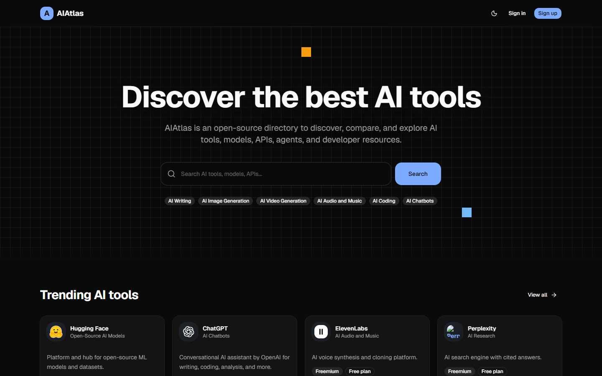
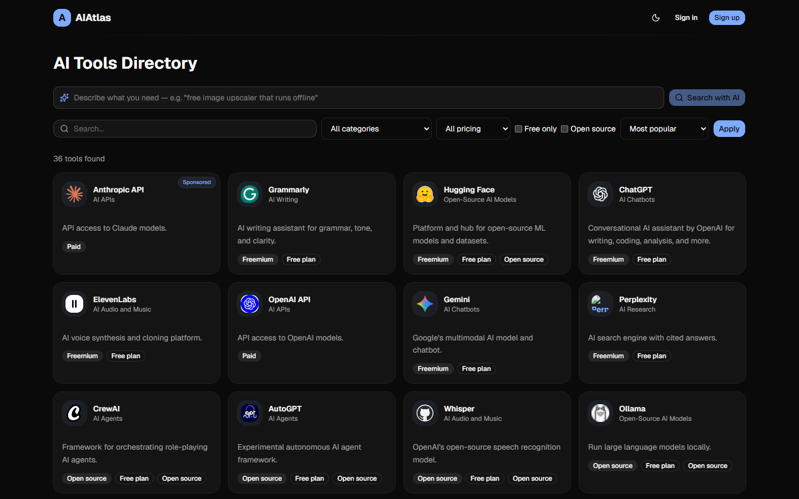
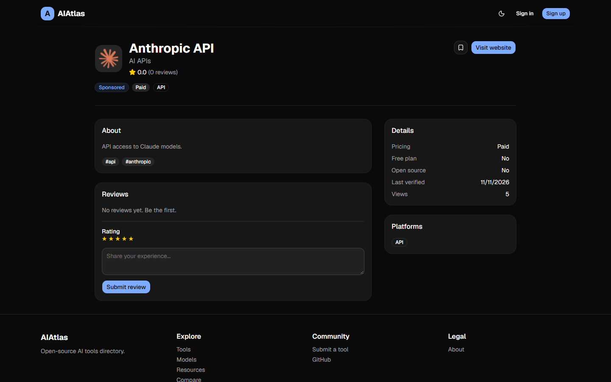
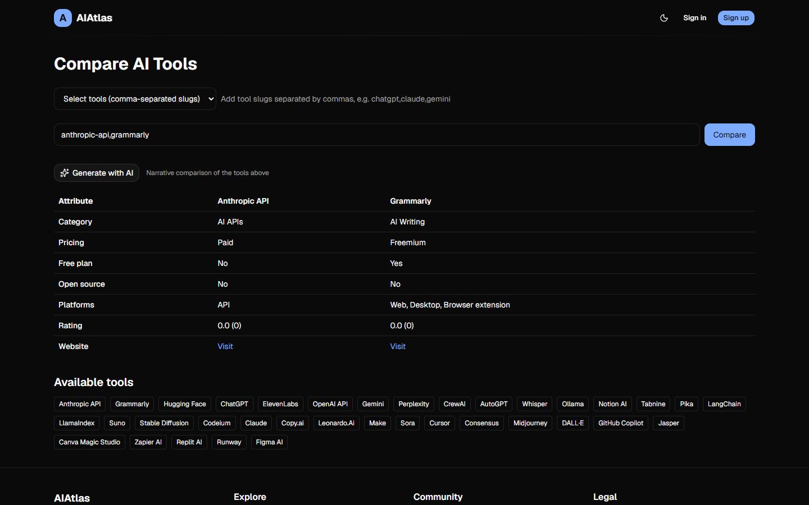
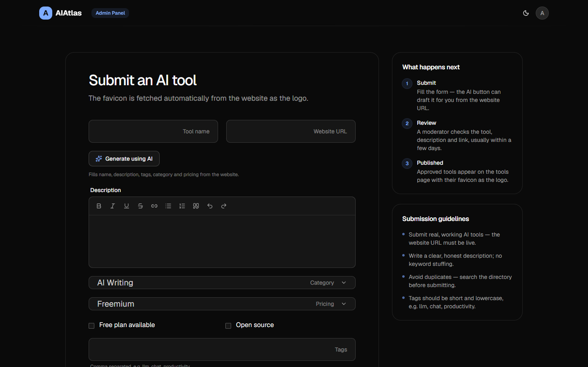
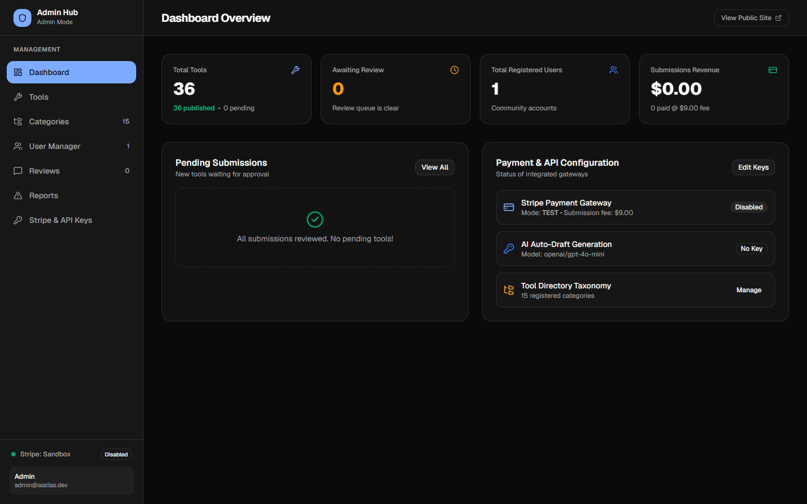

# AIAtlas

AIAtlas is an open-source directory and discovery platform for AI tools, models, APIs, agents, and developer resources.



## Features

- **Searchable directory** of AI tools across 15 categories, with filtering (category, pricing, free, open-source) and sorting
- **Natural-language search (AI)** — "free image upscaler that runs offline" is parsed into directory filters by OpenRouter
- **AI tool comparison** — narrative, "best for" comparisons generated from the tools' real sites
- **AI draft generation** — submit a URL and OpenRouter fills the submission form from the tool's website
- **Paid submissions & paid boosts (Stripe)** — one-time review fee and sponsored placements, all configurable from the admin panel
- **Tool health checks** — scheduled (`npm run health-check`) or on-demand; dead sites are flagged on their pages and in the admin
- **Rate limits** — Redis-backed limits on AI generation, submissions, and AI search (protects your OpenRouter bill)
- **AI models directory** (OpenAI, Anthropic, Google, Meta, Qwen, DeepSeek, Mistral, ...)
- **Developer resources** (APIs, SDKs, repos, datasets, docs, tutorials)
- **Community accounts**, submissions, reviews, bookmarks, reports
- **Full admin panel** — dashboard, moderation queue, user management, categories, reviews, reports, and settings for pricing/Stripe keys/OpenRouter
- **SEO**: dynamic metadata, sitemap, robots.txt
- **Light/dark mode**, responsive UI

## Screenshots

| | |
|---|---|
|  |  |
|  |  |



## Tech stack

- Next.js (App Router) + TypeScript
- Tailwind CSS + base-ui shadcn/ui
- PostgreSQL + Prisma ORM
- NextAuth (credentials)
- Redis (caching + rate limiting)
- Stripe (submissions & boosts)
- OpenRouter (AI features)
- Docker Compose

## Getting started

### Prerequisites

- Node.js 20+
- Docker (for PostgreSQL/Redis) or your own instances

### Setup

```bash
cp .env.example .env
# edit .env as needed
docker compose up -d db redis
npm install
npx prisma db push
npm run db:seed
npm run dev
```

Visit http://localhost:3000

### Admin access

After seeding, create an admin user manually or promote one via the database. Example:

```bash
npx tsx scripts/make-admin.ts
```

(Default admin: `admin@aiatlas.dev` / `password123` — dev only, change in production.)

### Configuration (admin panel)

All keys and pricing are configurable in **/admin → Stripe & API Keys** (no redeploy needed):

- Submission review fee + payment toggle
- Boost price and duration
- Stripe test/live secret keys and webhook secrets
- OpenRouter API key and model (powers AI search, compare, and draft generation)

AI and payment features degrade gracefully when keys are missing — the UI shows a clear "not configured" message.

## Scripts

- `npm run dev` — development server
- `npm run build` — production build
- `npm run start` — start production server
- `npm run health-check` — verify every approved tool's website is reachable (`-- --only-dead` to re-check flagged ones)
- `npm run lint` — lint
- `npm test` — run tests
- `npm run db:push` — sync schema
- `npm run db:seed` — seed data
- `npm run db:studio` — Prisma Studio

## Docker

```bash
docker compose up --build
```

## Project structure

See `docs/ARCHITECTURE.md`.

## Contributing

See `CONTRIBUTING.md`.

## License

MIT — see `LICENSE`.
